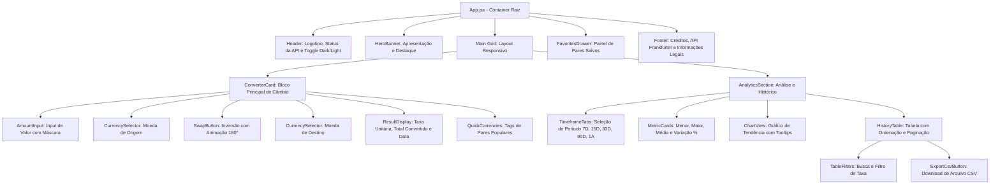

# Especificação de Interface e Protótipos (Figma Spec)
## Projeto: Currency Exchange App (Fintech SPA)

---

### 1. Link do Projeto Figma
- **URL do Protótipo Interativo**: [Figma - Currency Exchange App Prototype](https://www.figma.com/design/currency-exchange-app-senac) *(Link referencial de documentação de interface e prototipagem do projeto)*
- **Status do Design**: Finalizado / Aprovado (Design Tokens + Component Library + Wireframes Mobile e Desktop)

---

### 2. Design Tokens & Identidade Visual

A identidade visual foi concebida com estética **Fintech Premium**, combinando elementos de *glassmorphism*, gradientes suaves, alto contraste tipográfico e paletas otimizadas para ambientes escuro (Dark Mode padrão) e claro (Light Mode).

#### Paleta de Cores (CSS Custom Properties)

```css
/* Dark Theme (Padrão) */
--bg-primary: #0b0f19;          /* Fundo principal ultra-dark */
--bg-secondary: #111827;        /* Superfície dos cards */
--bg-card: rgba(17, 24, 39, 0.75); /* Card com glassmorphism */
--border-subtle: rgba(255, 255, 255, 0.08);
--border-focus: #3b82f6;        /* Azul elétrico */

--text-primary: #f9fafb;        /* Texto de alto contraste */
--text-secondary: #9ca3af;      /* Subtítulos e labels */
--text-muted: #6b7280;          /* Metadados e datas */

--accent-blue: #3b82f6;         /* Primário: Ações principais */
--accent-cyan: #06b6d4;         /* Destaque para gráficos e métricas */
--accent-green: #10b981;        /* Sucesso, valorização, lucros */
--accent-rose: #f43f5e;         /* Desvalorização, erros, alertas */
--accent-amber: #f59e0b;        /* Favoritos e avisos */

/* Gradientes */
--gradient-primary: linear-gradient(135deg, #2563eb 0%, #06b6d4 100%);
--gradient-card: linear-gradient(180deg, rgba(30, 41, 59, 0.5) 0%, rgba(15, 23, 42, 0.7) 100%);
--gradient-glow: radial-gradient(circle at 50% 0%, rgba(59, 130, 246, 0.15) 0%, transparent 70%);
```

#### Tipografia
- **Família Tipográfica**: `'Plus Jakarta Sans', 'Inter', -apple-system, sans-serif`
- **Escala de Tamanhos**:
  - `Display / Hero`: 36px / 44px (Bold - 700)
  - `Title H1/H2`: 24px / 32px (SemiBold - 600)
  - `Section H3`: 18px / 26px (Medium - 500)
  - `Body / Inputs`: 15px / 22px (Regular - 400)
  - `Small / Badges`: 12px / 16px (Medium - 500)

---

### 3. Mapeamento da Hierarquia de Componentes



---

### 4. Wireframes Textuais das Telas

#### Desktop Layout (1440px):
```
+-----------------------------------------------------------------------------------+
|  [Logo] CurrencyExchange                 [Status: API Conectada]  [☀/🌙 Tema]     |
+-----------------------------------------------------------------------------------+
|                                                                                   |
|  +-----------------------------------+  +--------------------------------------+  |
|  |       CONVERSOR DE MOEDAS         |  |        HISTÓRICO & TENDÊNCIA         |  |
|  |                                   |  |                                      |  |
|  |  Valor: [ 100.00            USD ] |  |  Período: [ 7D ] [15D] [30D] [90D]   |  |
|  |                                   |  |                                      |  |
|  |  [ Origem: USD ] (⇄) [ Dest: BRL] |  |  [ Mínima ]  [ Máxima ]  [ Variação] |  |
|  |                                   |  |   5.4520      5.6210       +2.14%    |  |
|  |  +-----------------------------+  |  |                                      |  |
|  |  | Total: R$ 558,84            |  |  |  [  Gráfico Interativo de Cotação ]  |  |
|  |  | 1 USD = 5.5884 BRL          |  |  |                                      |  |
|  |  +-----------------------------+  |  |                                      |  |
|  |  Atalhos: [USD/EUR] [EUR/BRL]     |  |  [ Buscar Data... ]  [ ⬇ Exportar CSV]|  |
|  +-----------------------------------+  |  [ Tabela com Ordenação Data/Taxa   ]|  |
|                                         +--------------------------------------+  |
+-----------------------------------------------------------------------------------+
|  Dados oficiais: Banco Central Europeu via Frankfurter API | Senac SP 2026        |
+-----------------------------------------------------------------------------------+
```

#### Mobile Layout (375px):
- Componentes empilhados verticalmente com espaçamentos fluidos (`clamp`).
- Botão de Swap centralizado com toque amplo para facilitar uso com uma mão.
- Gráfico com rolagem horizontal touch-friendly e tabela colapsável ou paginada.

---

### 5. Estados dos Componentes (UI States)

1. **Default**: Renderização regular dos elementos, campos prontos para interação.
2. **Hover / Focus**: Iluminação de borda em azul/ciano (`--border-focus`), sutil elevação (`transform: translateY(-2px)`).
3. **Loading**: Esqueletos animados (*shimmer effect*) no conversor, gráfico e métricas.
4. **Error**: Banner visual de erro com ícone de alerta, descrição da falha e botão de "Tentar Novamente".
5. **Empty State**: Ilustração em vetor minimalista quando uma busca na tabela não encontrar registros.
